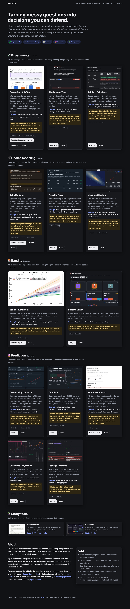

# Sunny Yu · Data Projects

A portfolio site with fifteen interactive or reproducible projects, grouped by the business question they answer. Each card has a screenshot, a plain-English description, the concept it shows, **what it taught me**, and links to the project and its code. It's static HTML with no build step.

Live at <https://sunnyy888.github.io/stats-portfolio/>

| Section | Projects |
|---|---|
| 🧪 Experiments | [Cookie Cats A/B test](https://github.com/sunnyy888/cookie-cats-ab) · [The Peeking Trap](https://github.com/sunnyy888/peeking-trap) · [A/B Test Calculator](https://github.com/sunnyy888/ab-test-calculator) |
| 🛒 Choice modeling | [Boba Conjoint](https://github.com/sunnyy888/boba-conjoint) · [Price the Fares](https://github.com/sunnyy888/pricing-sim) · [Likelihood Explorer](https://github.com/sunnyy888/likelihood-explorer) |
| 🎰 Bandits | [Bandit Tournament](https://github.com/sunnyy888/bandit-tournament) · [Beat the Bandit](https://github.com/sunnyy888/beat-the-bandit) |
| 🔮 Prediction | [Overbooking Optimizer](https://github.com/sunnyy888/overbooking-optimizer) · [Cutoff Lab](https://github.com/sunnyy888/cutoff-lab) · [ML Report Auditor](https://github.com/sunnyy888/ml-report-auditor) · [Overfitting Playground](https://github.com/sunnyy888/overfit-playground) · [Leakage Detective](https://github.com/sunnyy888/leakage-detective) |
| 📚 Study tools | [Practice Exam](https://github.com/sunnyy888/practice-exam) · [Flashcards](https://github.com/sunnyy888/flashcard-app) |
